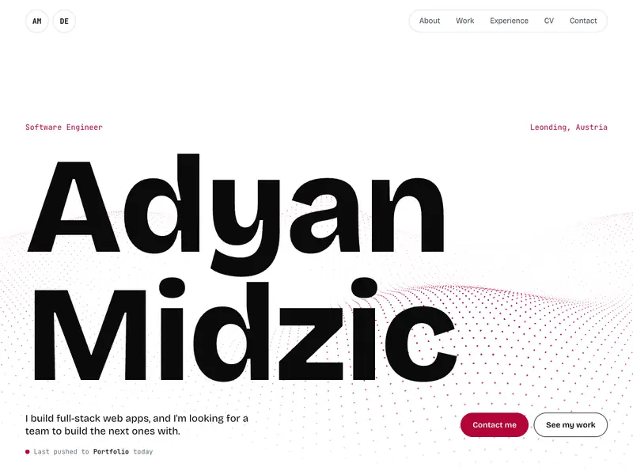

<div align="center">

# Portfolio

My personal portfolio website: who I am, what I've built and how to reach me.

[](https://github.com/AdyanMidzic08/Portfolio/actions/workflows/deploy.yml)


**[View the live site →](https://adyanmidzic08.github.io/Portfolio/)**



</div>

## Contents

- [Features](#features)
- [Tech stack](#tech-stack)
- [Getting started](#getting-started)
- [Project structure](#project-structure)
- [Customizing](#customizing)
- [Deployment](#deployment)
- [Contact](#contact)

## Features

- **Interactive 3D hero**: a point-cloud wave rendered with Three.js and custom GLSL shaders that reacts to the mouse.
- **Live GitHub projects**: the "Selected work" section loads my repositories from the GitHub API, with a built-in fallback list if the API is unreachable or rate-limited.
- **English and German**: the language follows the visitor's browser and can be switched at any time.
- **Dark mode**: follows the system setting, can be toggled, and the choice is remembered.
- **Downloadable CV** in both languages (PDF).
- **Polished motion**: smooth scrolling, animated text, magnetic buttons and a custom cursor.
- **Lightweight on weak devices**: phones with little memory or few cores, and visitors with data saver on, get a still image instead of WebGL.
- **Privacy-friendly**: no cookies, no tracking, with a legal notice and privacy text in the footer.

## Tech stack

| Area      | Tools                                                    |
| --------- | -------------------------------------------------------- |
| Framework | React 19, TypeScript, React Compiler                     |
| Build     | Vite                                                     |
| Styling   | Tailwind CSS 4                                           |
| 3D        | Three.js, React Three Fiber                              |
| Animation | Motion, Lenis (smooth scroll)                            |
| Icons     | React Icons                                              |
| Hosting   | GitHub Pages, deployed automatically via GitHub Actions  |

## Getting started

You need [Node.js](https://nodejs.org/) and npm.

```bash
git clone https://github.com/AdyanMidzic08/Portfolio.git
cd Portfolio
npm install
npm run dev
```

The dev server prints a local URL (usually `http://localhost:5173/Portfolio/`).

### Scripts

| Command           | What it does                                  |
| ----------------- | --------------------------------------------- |
| `npm run dev`     | Starts the dev server with hot reload         |
| `npm run build`   | Type-checks and builds the site into `dist/`  |
| `npm run preview` | Serves the production build locally           |
| `npm run lint`    | Runs ESLint                                   |

## Project structure

```
├── public/
│   ├── assets/          # Profile photo, hero fallback image, project images
│   └── cv/              # CV as PDF (en.pdf, de.pdf)
├── src/
│   ├── components/      # Page sections (Hero, About, Work, Experience, Cv, Contact)
│   │                    # and effects (Field, Cursor, Magnetic, Marquee, Loader)
│   ├── data.ts          # All content: texts in EN/DE, tech stack, project settings
│   ├── lib.ts           # Hooks and helpers (GitHub API, language, theme, scrolling)
│   ├── ui.ts            # Shared button and style classes
│   └── App.tsx          # Page layout
└── .github/workflows/   # Deployment to GitHub Pages
```

## Customizing

Almost all content lives in [`src/data.ts`](src/data.ts):

- `USER`: the GitHub username whose repositories are shown.
- `TECH`: the tech stack with its icons.
- `HIDDEN_REPOS` and `MAX_PROJECTS`: which repositories to hide and how many to show.
- `SHOTS` and `STACKS`: the image and full tech stack for each project card.
- `FALLBACK_REPOS`: projects shown when the GitHub API can't be reached.
- `en` / `de`: every text on the page in both languages.

## Deployment

Every push to `main` builds the site and publishes it to GitHub Pages through [`.github/workflows/deploy.yml`](.github/workflows/deploy.yml).

The site is served from `/Portfolio/`, which is set as `base` in [`vite.config.ts`](vite.config.ts). If the site moves to its own domain, change `base` to `'/'`.

## Contact

**Adyan Midzic**, student at HTL Leonding, Austria
[GitHub](https://github.com/AdyanMidzic08) · [Portfolio](https://adyanmidzic08.github.io/Portfolio/)
